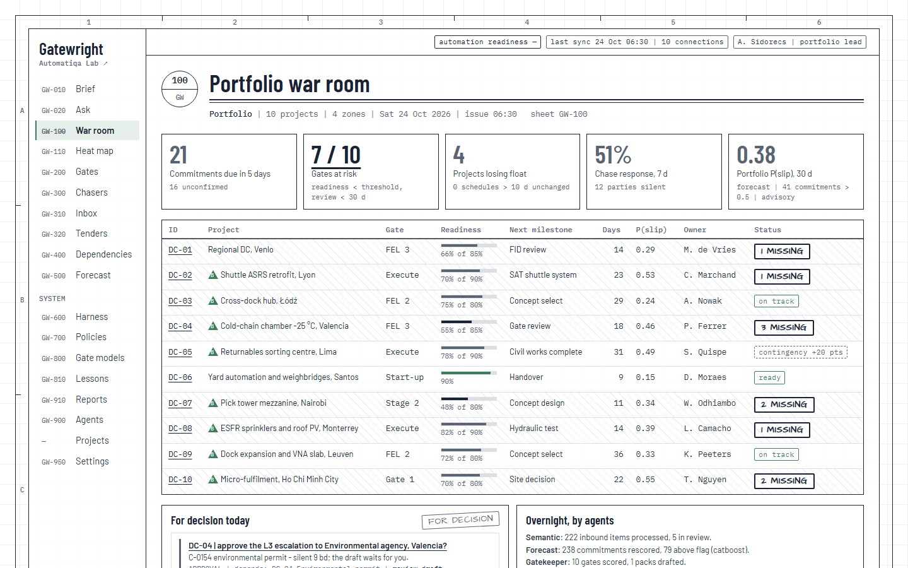
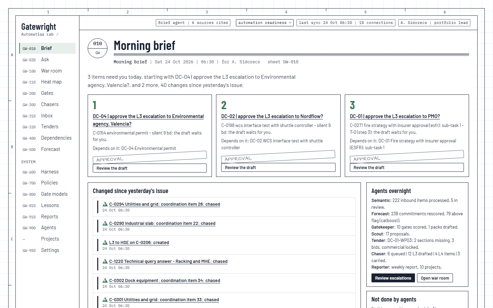
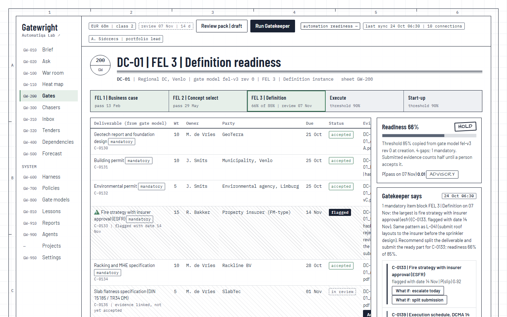
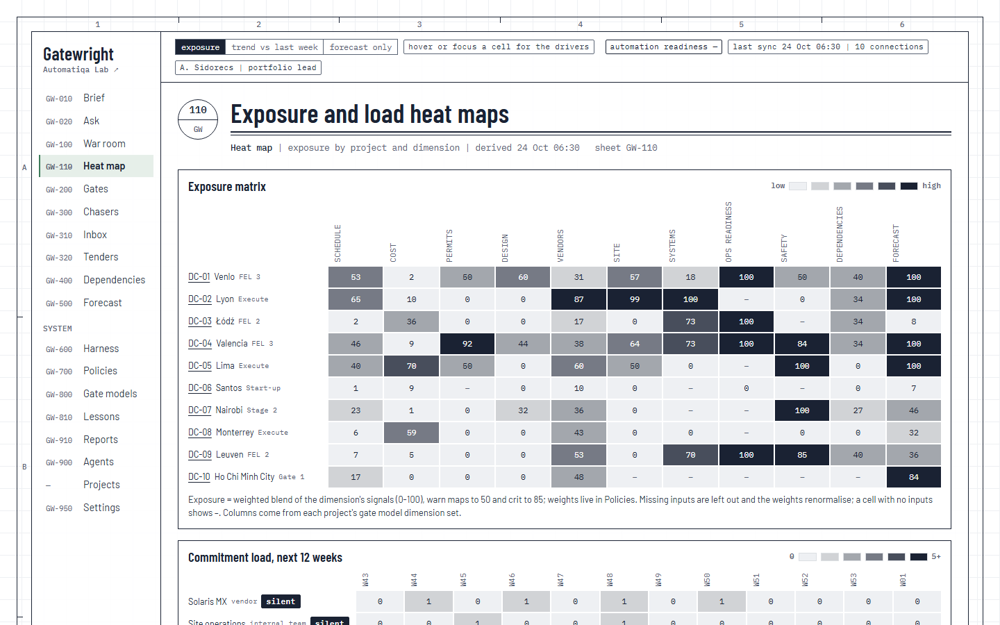
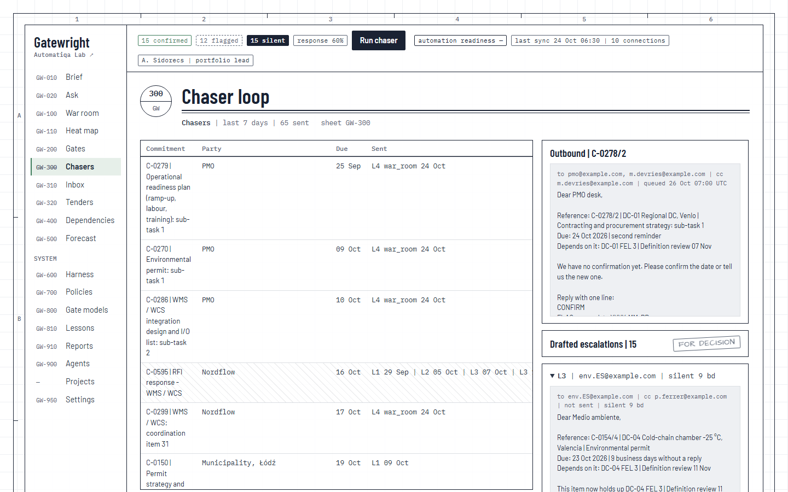
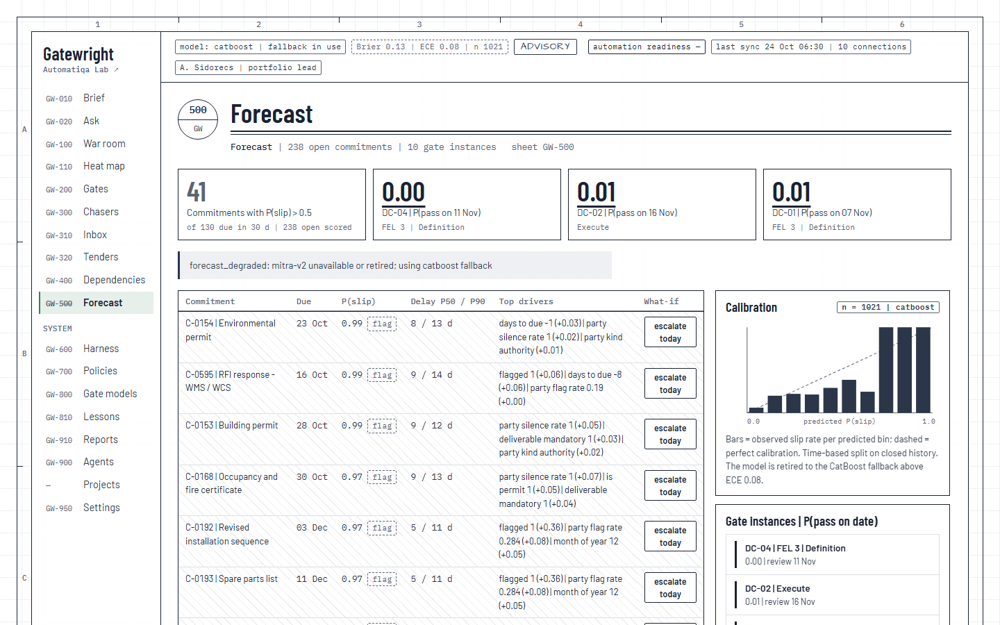

# Gatewright - AI PMO harness for capital project delivery

Gatewright is an open-source PMO harness for programmes that run on gates - capital projects
first, and equally M&A integrations, transformation and TOM roll-outs, product and ERP programmes.
It connects your schedule tool, planner, mailbox and document store, scores each gate against a
configurable gate model, runs chasers and forecasts, and exposes everything as MCP tools. Every
agent action sits on an auditable record; people stamp the decisions.

Not related to OPA Gatekeeper (Kubernetes) or macOS Gatekeeper.

Part of [Automatiqa Lab](https://www.automatiqa.io). Project page: [automatiqa.io/gatewright](https://www.automatiqa.io/gatewright/).


*Figure 1 - How Gatewright works. By Aleks Sidorecs.*

## The rule it enforces

A project advances on evidence, not on the strength of its sponsor.

## How it works

1. **Connections, read only.** Schedule tools (P6 through p6-mcp, XER and MSPDI files through
   longpath or directly, MS Project, Smartsheet), planners (Planner, Jira, Asana), the mailbox and
   Teams, document stores, cost exports and calendars are registered connections. Gatewright reads
   them; it never writes to a schedule.
2. **Gate models are data.** FEL, RIBA 2020, FEP/BEE, PRINCE2 stages and a three-gate site model
   ship for capital projects; `integration-100-day` ships for M&A integrations.
3. **The harness** holds the registry, nine capability contracts and connection health, and syncs
   each connection on its own cadence.
4. **One record, derived signals.** Gates, commitments, parties and evidence live on one record
   with an event log. Every indicator - readiness, float erosion, response rate, exposure - is
   computed from it; nobody types a RAG status.
5. **Three engines.** The semantic engine classifies replies and documents and links evidence;
   retrieval indexes the record without storing document bodies; the forecast engine scores slip and
   gate-pass probability, calibrated, with its drivers shown.
6. **Bounded agents** - chaser, gatekeeper, scout, tender, brief, reporter and an assistant. One
   job, one input snapshot, one output type, one autonomy level, one audit record each.
7. **Autonomy is earned.** Agents observe, propose, draft or act; a person approves until the
   automation readiness score - the share of outputs approved unchanged over 30 days - earns the
   next step.
8. **Three hard limits, in code, not policy:** never write to a schedule tool; never message a
   sponsor or authority without a recorded approval; never send text to an external model without
   the redactor.
9. **Real time.** Record events start debounced, rate-limited agent runs: a reply, an evidence
   decision or an approval is acted on within seconds, through the same governed paths as the
   schedule, and every sheet shows what changed while it was open.
10. **People stamp.** Pass, hold and escalate are decisions by named people with roles, recorded as
    events.

## What it does

| Capability | Sheet | Module |
|---|---|---|
| Morning brief | GW-010 | brief agent |
| Ask the record: answers with citations, proposed next steps | GW-020 | assistant agent |
| Portfolio war room with leading indicators | GW-100 | signals, record |
| Exposure and commitment-load heat maps | GW-110 | signals |
| Gate readiness scored against a configurable gate model | GW-200 | standards, gatekeeper agent |
| Closed chaser loop with structured replies and an approved escalation ladder | GW-300 | chaser agent, semantic engine |
| Commitment sheet: chases, evidence, forecast, audit trail | GW-305 | record |
| Inbox intelligence: classify replies and documents, link evidence | GW-310 | semantic engine, retrieval |
| Tender package check, technical before commercial | GW-320 | tender agent |
| Interdependency proposals across projects | GW-400 | scout agent |
| Slip and gate-pass forecasts with drivers, calibration and what-if | GW-500 | prediction engine |
| Connection harness with capability contracts | GW-600 | harness |
| Policies: cadences, ladders, autonomy, thresholds, models, real time | GW-700 | policies, governance |
| Gate model editor and lessons library | GW-800, GW-810 | standards |
| Agent runs, approvals and SteerCo reports | GW-900, GW-910 | runner, reporter agent |
| Users, roles, tokens, retention and privacy | GW-950 | governance |

Every function is also an MCP tool (`gw.*`), REST endpoint and CLI command, so any MCP client - an AI assistant or
your own agent - sees the same record under the same approvals.

## Screens

All screens below come from the bundled synthetic demo (`gw demo --seed 7`): invented projects,
parties and people, nothing real.

| | |
|---|---|
|  |  |
| **War room** - leading indicators across the portfolio | **Morning brief** - three decisions, what changed, what the agents did |
|  |  |
| **Gate** - readiness against the gate model, gaps and levers | **Heat map** - exposure by project and dimension |
|  |  |
| **Chasers** - the ladder, replies and drafts for approval | **Forecast** - slip probability, drivers, what-if, calibration |

## Language models: any provider, none required

Gatewright runs without a language model: every message, note and brief has a template over the
record. Point a policy at a chat connection and the model adds two things:

- **Drafting.** The chaser's escalation, the gatekeeper's note and the brief's opening are reworded
  by the model, and kept only if every fact survives a check (kept lines verbatim, no new number,
  date, code, address or link). Otherwise the template stands, and the run records why.
- **The assistant.** A tool-using agent answers questions from the record as the asking user, with
  that user's roles, and proposes next steps for a person to take on the linked sheet. It reads and
  proposes; it never sends, decides or changes anything. Any number or code in an answer that no
  tool returned is flagged to the reader as not found in the record.

Small local models often fall back to the templates, because the fact check rejects their
rewording; larger local models and hosted models get more drafts accepted. Either way the text
that goes out is correct.

Models sit behind one model-neutral contract (`ChatModel`), so agents and engines never name a
provider or a model. Adapters ship for a local Ollama server, any OpenAI-compatible endpoint (vLLM,
LM Studio, llama.cpp, Azure OpenAI, Mistral, OpenRouter) and the Anthropic API (extra
`gatewright[anthropic]`). External providers see redacted text only; per-agent token budgets, step
limits and hourly rates apply.

```yaml
# examples/connections.yaml - one chat connection, any provider
- {id: llm, contract: ModelProvider, adapter: ollama, name: Local model,
   config: {base_url: "http://localhost:11434", llm: "your-model"}, scopes: [infer]}
# policies (GW-700)
models:
  drafting:  {connection: llm, agents: [chaser, gatekeeper, brief]}
  assistant: {connection: llm}
```

## Connect your agent (MCP)

The whole stack is an MCP server, so a PMO can point its own agent or AI assistant at the record.
The agent gets the same `gw.*` tools as the sheets (portfolio, gates and gaps, commitments, chases,
evidence, forecasts and what-ifs, search, dependencies, approvals, audit, the brief and `gw.ask`),
under the signed-in user's roles: it can only do what that person may do, every call is audited, and
the three hard limits apply to it like to everyone else.

Local, over stdio (the agent runs on the same machine):

```json
{ "mcpServers": { "gatewright": { "command": "gw", "args": ["mcp", "--db", "/path/to/gw.duckdb", "--user", "aleks"] } } }
```

Remote, over streamable HTTP (`gw serve --mcp-http`, login mode, one token per person or service
account from `gw user token <short>`):

```json
{ "mcpServers": { "gatewright": { "url": "https://gatewright.example.com/mcp",
                                  "headers": { "Authorization": "Bearer gwt_..." } } } }
```

## What it is not

Not a scheduling tool (schedules are read through P6, MS Project, Smartsheet, XER/MSPDI files),
not a document store (evidence is a link and a hash), not an autonomous PMO (agents observe,
propose, draft or act within policy; three hard limits are fixed in code).

## Beyond capital projects

The chaser, readiness scoring, inbox intelligence and forecast transfer unchanged to any gated
programme run from Planner or Jira. Schedule signals (float erosion, DCMA 14, critical path) need a
schedule network and are simply absent for a programme that runs on a task list - Gatewright never
fabricates them.

## Status

Working software, tested against two synthetic portfolios (capital projects and M&A
integrations): solo mode on DuckDB, team mode on Postgres with OIDC sign-in, live Microsoft 365
through delegated device-code sign-in, schedule MCP servers verified against longpath and p6-mcp.
Production use on your own data starts with `gw serve` in login mode behind TLS.

## Quick start

The repository ships everything needed to try it end to end, with no account and no real data:

- **a synthetic portfolio generator** (`gw demo`): 10 capital projects, or 6 M&A integrations, with
  invented parties and people, gate histories, schedules, plans, cost exports, inbound replies and
  documents, and 24 months of history for the forecast;
- **examples**: six gate models, a complete policy file with every setting and its default, and an
  example connection for each adapter, all with synthetic values.

```
uv sync
uv run gw demo --seed 7        # synthetic capital portfolio into ./gw.duckdb, then one morning of agents
uv run gw serve                # web sheets and REST on http://127.0.0.1:8000, scheduler and real time in-process
uv run gw mcp                  # MCP server `gatewright` over stdio (gw.* tools)
uv run gw score --gate DC-01/fel3
uv run gw chase --dry-run      # what the chaser would send today
uv run gw brief --user aleks
uv run gw ask "Which gates are at risk this month?"   # needs policies.models.assistant.connection
```

`gw demo` writes its fixtures (MSPDI schedules, Planner plan, cost CSV, mail and document fixtures,
labelled corpus, forecast priors) to `./demo-data`. Chases the demo sends land as text files in
`./demo-data/outbox`; nothing leaves the machine. A second portfolio (M&A integrations, task lists
only): `uv run gw demo --portfolio integration`.

## Running it for real

```
uv run gw user password aleks            # first password switches on login mode (argon2, CSRF, throttling)
uv run gw user token aleks               # API / MCP-over-HTTP bearer token (stored hashed, shown once)
GW_SESSION_KEY=<32+ random bytes> uv run gw serve --host 127.0.0.1   # behind a TLS reverse proxy
uv run gw serve --mcp-http               # MCP at /mcp (bearer token = principal)
uv run gw webhook URL --events approval.requested,gate.at_risk --secret-ref hook-key
docker compose up -d                     # solo server; data in a volume
```

Deployment settings (environment):

| Variable | Default | Purpose |
|---|---|---|
| `GW_DB` | `gw.duckdb` | DuckDB file or SQLAlchemy URL (Postgres in team mode) |
| `GW_SESSION_KEY` | key file outside the repo | session signing key, 32+ characters |
| `GW_SESSION_HOURS` | 12 | session lifetime |
| `GW_LOGIN_MAX_FAILS` / `GW_LOGIN_WINDOW_SECONDS` | 8 / 900 | sign-in throttle per client and per account |
| `GW_FORWARDED_ALLOW_IPS` | empty | your reverse proxy's address, so client address and https come from it (never `*`) |
| `GW_PUBLIC_HTTPS` | 0 | 1 marks every cookie `Secure` behind TLS |
| `GW_SECRET_<NAME>` | - | secrets that connections name by key (`secret_ref: <name>`) |

Everything operational - cadences, escalation ladder, thresholds, signal windows, gate rules,
forecast settings, model connections, real-time reactions, schedules, retention - is policy:
edit it on the Policies sheet (GW-700) or with `gw policy set <file>`. Every save is a validated,
versioned revision; anything a revision leaves out takes the shipped default from
`examples/policies.yaml`.

No-login (trust) mode serves the person at the machine only: it refuses any request relayed by a
proxy or addressed to another host. Anything other people can reach runs in login mode. Responses
carry a strict Content-Security-Policy; secrets are read by key name and never stored in the
repository, the database or logs.

Live Microsoft 365 (delegated device-code sign-in, no client secret): copy
`examples/connections.local.example.yaml` to `connections.local.yaml`, fill in tenant, client id and
mailbox, then `gw harness add connections.local.yaml` and `gw harness login mail-live`. The token cache
is encrypted per user outside the project folder.

Team sign-in through Entra or Google: add an `oidc` IdentitySource connection with `issuer`,
`client_id`, `allowed_domains` and a `group_map` from your groups to Gatewright roles.

In-context tabular models on a GPU machine: run `python -m gw.harness.tabular_server` there (it binds
the machine's loopback only and checks a bearer token), reach it through an SSH tunnel, and add a
`remote_tabular` connection (example in `examples/connections.yaml`). With the machine off, the
forecast falls back to CatBoost and says so.

Optional extras: `gatewright[graph]` (Microsoft Graph), `gatewright[anthropic]` (Anthropic API adapter),
`gatewright[embeddings]` (sentence-transformers), `gatewright[mitra]` (Mitra-v2 via AutoGluon),
`gatewright[tabicl]`, `gatewright[oidc]`, `gatewright[postgres]`, and
`gatewright[tabpfn-noncommercial]` (non-commercial weights; off unless a connection opts in).

## Upgrading

```
GW_DB=gw.duckdb uv run alembic upgrade head   # apply database migrations after an upgrade
```

## Reference

- `examples/policies.yaml` - every setting with its default and a comment
- `examples/gatemodels/` - FEL, RIBA 2020, FEP/BEE, PRINCE2 stages, three-gate, integration-100-day
- `examples/connections.yaml` - one connection per adapter, synthetic values
- `schemas/` - JSON Schemas for policies and gate models

## EU AI Act

Gatewright's agents can draft text with a language model - chases, gate notes, the brief, the
assistant's answers - so that output carries transparency marking under Article 50. Models are off
by default; the synthetic demo runs on templates and produces nothing to mark.

- Only content a model wrote is marked. Template text, content a person wrote or edited, and numbers
  from signals and forecasts are not; signals and forecasts carry their provenance in the event log.
- Marking travels in two channels: a line people can read (a "drafted by AI" chip on the sheet, an
  "AI-assisted" line on a message, approval card or CLI output, and a session notice on the
  assistant sheet) and metadata a machine can detect - the `ai_generated` envelope in REST and MCP
  results, an `X-AI-Generated` header and `ai-*` meta tags on sheets. The schema is
  `automatiqa-disclosure/1`.
- The model is never named in visible output.

If you deploy Gatewright for other people in the EU you are a deployer: keep the marking intact and
make sure recipients can recognise AI-generated content as such.

Full classification and reasoning: [COMPLIANCE.md](COMPLIANCE.md).

## Licence

MIT. See [LICENSE](LICENSE) and [NOTICE](NOTICE).
